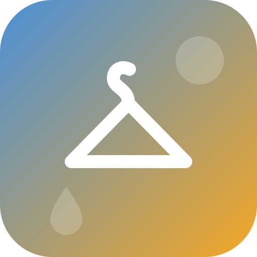

<p align="center">
  
</p>

<p align="center">
  <a href="https://my.home-assistant.io/redirect/marketplace_repository/?owner=pschmitt&amp;repository=homeassistant-what-should-i-wear&amp;category=integration"></a>
</p>

<h1 align="center">What Should I Wear?</h1>

<p align="center">Turn an hourly weather forecast into per-person advice for sandals, jackets and rain protection.</p>

## Features

- **Personal profiles:** Give each household member independent temperature and rain thresholds.
- **Forecast lookahead:** Consider the current conditions and upcoming hourly forecast, six hours by default.
- **Clothing advice:** Expose sandals, jacket and rain-protection binary sensors plus a readable recommendation.
- **Wind-aware rain gear:** Advise a rain jacket instead of an umbrella in strong wind.

## Install

Use the Marketplace badge above on Home Assistant 2026.11 or later to add this
repository as a custom integration. On older versions, add it as a HACS
custom repository of type **Integration**. Install and restart Home Assistant.
The badge does not imply a public catalog listing.

## Quick start

1. Add **What Should I Wear?** under **Settings → Devices & services → Add
   integration** and select an hourly-forecast weather entity and lookahead.
2. Use **Add person** to set each person's sandals, jacket and rain thresholds.
3. Add the resulting recommendation sensor to a dashboard; for a profile named
   Alex, a native Markdown card can show the recommendation and message:

   ```yaml
   type: markdown
   content: >
     ## {{ state_attr('sensor.alex_what_to_wear', 'recommendation') }}
     {{ state_attr('sensor.alex_what_to_wear', 'message') }}
   ```

## License

[GPL-3.0](LICENSE).
