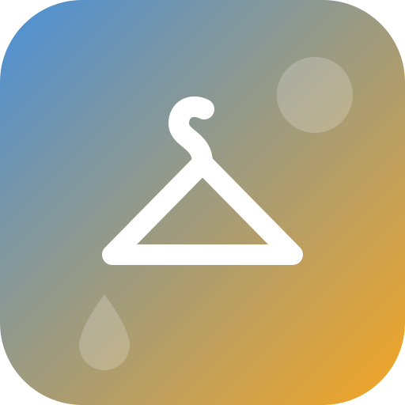

# What Should I Wear? — Home Assistant integration



A tiny outfit advisor for Home Assistant. It reads an **hourly weather
forecast** and tells each person whether to wear sandals, take a jacket, and
grab rain gear (umbrella or rain jacket) — now and over the next few hours.

It is built for households where people have **different comfort levels**: each
person is a separate profile with their own thresholds, so the same weather can
say "sandals fine" for one person and "bring a jacket" for another.

## Features

- **Per-person profiles** as config subentries — add/edit/remove people from
  the UI, each with their own thresholds.
- Reads any weather entity that provides an **hourly forecast** (e.g.
  OpenWeatherMap).
- Looks at **now + the next _N_ hours** (configurable, default 6) so it catches
  afternoon rain after a dry morning.
- Per person it exposes:
  - `binary_sensor` **Sandals OK** — warm enough and staying dry.
  - `binary_sensor` **Rain protection** — umbrella or rain jacket needed.
  - `binary_sensor` **Jacket** — it gets cold enough in the window.
  - `sensor` **What to wear** — a short recommendation string plus a friendly
    message and all the driving numbers as attributes.

In strong wind, rain advice automatically flips from umbrella to rain jacket.

## Configuration

1. **Settings → Devices & Services → Add Integration → What Should I Wear?**
2. Pick the weather entity and lookahead.
3. On the integration, use **Add person** to create a profile per household
   member and set their thresholds:
   - **Sandals from** — temperature at/above which sandals are fine.
   - **Jacket below** — temperature at/below which a jacket is advised.
   - **Rain gear from** — precipitation probability that warrants rain gear.
   - **Prefer umbrella over rain jacket** — wording/icon preference for rain.

## Example dashboard usage

```yaml
type: markdown
content: >
  ## {{ state_attr('sensor.philipp_what_to_wear', 'recommendation') }}
  {{ state_attr('sensor.philipp_what_to_wear', 'message') }}
```

## License

[GPL-3.0](./LICENSE)
